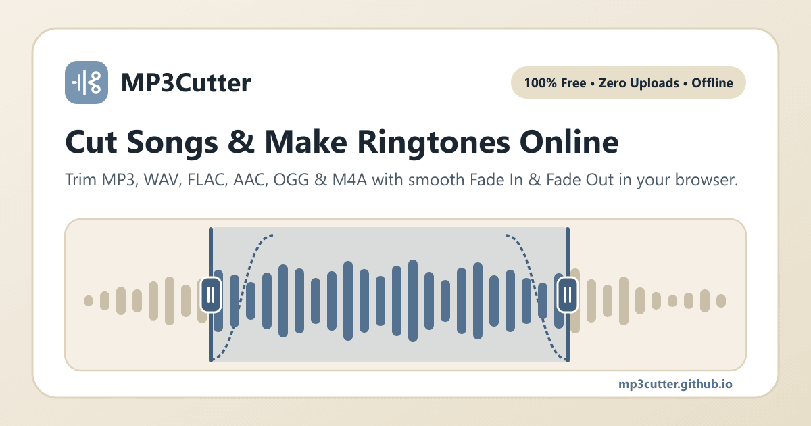

<div align="center">


# MP3Cutter

**Fast, private, 100% browser-based MP3 cutter, audio trimmer, and ringtone maker.**  
Trim songs, cut out middle sections, apply smooth fade-in/fade-out envelopes, and export MP3, lossless WAV, or iPhone M4R ringtones—with **zero server uploads** and full **offline PWA** support.

[](https://mp3cutter.github.io/)
[](https://astro.build/)
[](https://react.dev/)
[](./LICENSE)

<br />



</div>

---

## Why MP3Cutter?

Most online audio cutters upload your private recordings to remote servers, throttle export quality, or bury controls behind ads and sign-up walls. **MP3Cutter** runs completely inside your browser using the Web Audio API, WebAssembly, and WebCodecs—so your audio files never leave your device and edits finish in seconds, even offline.

---

## Key Features

### Pro DAW-Style Browser Studio
- **Interactive High-DPI Waveform & Time Ruler:** Hardware-accelerated HTML5 `<canvas>` waveform with dynamic time ticks, subtle vertical gridlines, `1x`–`8x` zoom, hover crosshair with live timestamp readout, and draggable/keyboard-accessible (`role="slider"`) Start & End handles.
- **Precision Playhead Scrubbing & Live Mark-In / Mark-Out:**
  - Click or drag anywhere on the waveform to position the persistent playhead without unwanted autoplay.
  - Pause in place, nudge **`−2s` / `+2s`**, and set cut boundaries directly from the playhead with one-click **`Set Start` (`I`)** and **`Set End` (`O`)**—even live while listening.
  - Switch seamlessly between full-track **`Play`** and edited **`Preview Cut` (`P`)** with optional **`Loop`** playback to audition fades and splice points before exporting.
- **Keep Selection (Trim) & Remove Selection (Cut):** Save only your highlighted chorus or remove an unwanted middle section from podcasts and voice notes with smooth click-free splice crossfading.
- **Smooth Fade In & Fade Out (`0s`–`5s`):** 32-bit floating-point raised-cosine fade envelopes rendered live as smooth Bezier curves directly over the waveform.
- **One-Click Productivity Helpers:** **`30s Ringtone Preset`**, automatic **`Trim Silence`** RMS boundary detection, and an offline **`Try Sample Audio`** synthesizer to test the workspace immediately.

### Resilient Multi-Stage Audio Engine (100% Client-Side)
- **Broad Local Input Support:** Open **MP3, WAV, FLAC, AAC, OGG, and M4A** tracks, or extract and trim audio directly from local **MP4, WebM, and MOV** video files.
- **4-Stage Fault-Tolerant Decoding:**
  1. Hardware-independent `OfflineAudioContext.decodeAudioData()` fast path (zero RAM duplication).
  2. Resilient pure-TypeScript **RIFF/WAVE** parser fallback (8/16/24/32-bit PCM, 32-bit IEEE Float, and `WAVEFORMATEXTENSIBLE`).
  3. Automatic **ID3v2 / leading junk-byte stripper** for MP3 files with malformed metadata headers.
  4. Lazy-loaded pure WebAssembly **`mpg123-decoder`** fallback (`~60 KB` gzipped, `0 KB` on initial load) so MP3s decode even in browsers without native proprietary MP3 codecs.
- **Flexible Exports:**
  - **MP3** (`128k`, `192k`, or `320k` kbps) via chunked client-side `@breezystack/lamejs` encoding.
  - **WAV** lossless 16-bit signed PCM.
  - **M4R** AAC-in-MP4 iPhone ringtone via WebCodecs `AudioEncoder` (`mp4a.40.2`) + `mp4-muxer`.

### Minimal Design, Performance, SEO & Offline PWA
- **Distraction-Free Interface:** Ultra-clean Warm Cream (`#F5EFE6`), Soft Sand (`#E8DFCA`), Mist Blue (`#AEBDCA`), and Steel Blue (`#7895B2`) Light & Dark themes with anti-FOUC persistence, self-hosted `Plus Jakarta Sans` & `JetBrains Mono` variable fonts, WCAG AA (`>= 4.5:1`) contrast, and a minimal top navigation bar with secondary controls organized inside a single toggle menu.
- **Zero-JS Static Shell:** Built on **Astro 5 Islands Architecture**—`0 KB` React/framework JS on `/how-to-use/` and `/hire-me/`, with the interactive studio hydrated strictly on Home via `client:load`.
- **8 Built-In Languages:** Full localized routes, UI copy, and reciprocal `hreflang` alternates (`x-default` included) for English (`/`), Español (`/es/`), Português (`/pt/`), Deutsch (`/de/`), Français (`/fr/`), 日本語 (`/ja/`), 简体中文 (`/zh/`), and Русский (`/ru/`).
- **Offline PWA:** Includes `manifest.webmanifest`, cache-first `sw.js` Service Worker, native `beforeinstallprompt` install flow, and iOS Safari **Add to Home Screen** guidance.
- **Technical SEO Ready:** Flat Google Search Console-ready `sitemap.xml` (`<urlset>` across all 24 localized URLs with `xhtml:link` alternates), `robots.txt`, Open Graph/Twitter Cards (`1200×630` `og-image.png`), and clean JSON-LD (`WebApplication`, `FAQPage`, `BreadcrumbList`, `HowTo`, `Person`).

---

## Keyboard Shortcuts

| Shortcut | Action |
| :--- | :--- |
| `Space` | Play / Pause full track from playhead (freezes playhead in place) |
| `I` | **Set Start** point at current playhead position |
| `O` | **Set End** point at current playhead position |
| `P` | Toggle **Preview Cut** (audition edited output + fades) |
| `←` / `→` | Fine-step focused Start/End trim handle by `±0.1s` |
| `Shift` + `←` / `→` | Step focused Start/End trim handle by `±1.0s` |
| `Home` / `End` | Jump focused trim handle to its min/max boundary |

---

## Tech Stack

| Layer | Technology |
| :--- | :--- |
| **Framework** | [Astro 5](https://astro.build/) (Static output, Islands Architecture) |
| **Interactive Island** | [React 19](https://react.dev/) + TypeScript |
| **Styling & Fonts** | [Tailwind CSS](https://tailwindcss.com/) + self-hosted `@fontsource-variable/plus-jakarta-sans` & `@fontsource-variable/jetbrains-mono` |
| **Audio Decoding** | Web Audio API (`OfflineAudioContext`) + [`mpg123-decoder`](https://github.com/eshaz/wasm-audio-decoders) (WASM) + native TS WAV parser |
| **Audio Encoding** | [`@breezystack/lamejs`](https://github.com/breezystack/lamejs) (MP3) · Native 16-bit PCM (WAV) · WebCodecs + [`mp4-muxer`](https://github.com/Vanilagy/mp4-muxer) (M4R) |
| **Hosting & CI/CD** | GitHub Pages via GitHub Actions (`.github/workflows/deploy.yml`) |

---

## Project Structure

```text
├── .github/
│   ├── FUNDING.yml                 # Sponsor link configuration
│   └── workflows/deploy.yml        # Automated GitHub Pages build & deploy
├── public/
│   ├── icons/                      # PWA PNG icons (180, 192, 512)
│   ├── favicon.svg                 # Brand waveform-scissors icon
│   ├── manifest.webmanifest        # Offline PWA manifest
│   ├── og-image.png                # Static 1200x630 Open Graph preview
│   ├── robots.txt                  # Crawl & sitemap directive
│   └── sw.js                       # Cache-first Service Worker
├── src/
│   ├── components/
│   │   ├── Breadcrumbs.astro       # Subpage semantic breadcrumbs
│   │   ├── Footer.astro            # Minimal footer & language links
│   │   ├── HireMePage.astro        # Freelance & developer profile view
│   │   ├── HomePage.astro          # Full-viewport hero studio + FAQ
│   │   ├── HowToUsePage.astro      # Step-by-step guide & workflows
│   │   ├── Mp3CutterIsland.tsx     # Interactive DAW studio React island
│   │   └── Navbar.astro            # Minimal nav + unified toggle popover
│   ├── i18n/
│   │   ├── config.ts               # 8 locales, canonical & hreflang helpers
│   │   ├── locales/                # Natural translations (en/es/pt/de/fr/ja/zh/ru)
│   │   ├── translations.ts         # Unified i18n registry
│   │   └── types.ts                # Strictly typed translation schema
│   ├── layouts/
│   │   └── BaseLayout.astro        # Anti-FOUC theme, meta, OG, JSON-LD, SW
│   ├── pages/
│   │   ├── [lang]/                 # Static localized routes (7 non-EN locales)
│   │   ├── index.astro             # English Home (/)
│   │   ├── how-to-use.astro        # English How to Use (/how-to-use/)
│   │   ├── hire-me.astro           # English Hire Me (/hire-me/)
│   │   └── sitemap.xml.ts          # Flat GSC-ready XML sitemap endpoint
│   ├── styles/
│   │   └── global.css              # Light/Dark RGB CSS tokens & studio styles
│   └── utils/
│       ├── audioEngine.ts          # Decode, edit, fade, WAV/MP3/M4R engine
│       └── schemas.ts              # JSON-LD structured data generators
├── astro.config.mjs
├── tailwind.config.mjs
└── package.json
```

---

## Local Development

### Prerequisites

- **Node.js** `20+` (tested on Node `22` / `24`)
- **npm** `10+`

### Commands

```bash
# 1. Clone the repository
git clone https://github.com/mp3cutter/mp3cutter.github.io.git
cd mp3cutter.github.io

# 2. Install dependencies
npm install

# 3. Start local development server
npm run dev

# 4. Run Astro/TypeScript diagnostics and build static production output into dist/
npm run build

# 5. Preview the production static build locally
npm run preview
```

---

## Deployment (GitHub Pages)

Automated deployment is configured in [`.github/workflows/deploy.yml`](.github/workflows/deploy.yml):

1. In your GitHub repository, navigate to **Settings → Pages → Build and deployment** and set **Source** to **GitHub Actions**.
2. Push to `main` (or trigger **Actions → Deploy MP3Cutter to GitHub Pages → Run workflow**).
3. GitHub Actions builds the static Astro site—including all 24 localized pages, the flat `/sitemap.xml`, `/robots.txt`, `/manifest.webmanifest`, and `/sw.js`—and publishes directly to `https://mp3cutter.github.io/`.

---

## Support & Freelance Inquiries

MP3Cutter is designed and maintained by **Kishara Dilshan**.

- **Support the Developer:** [Buy me a coffee on Gumroad](https://kisharadilshan.gumroad.com/coffee)
- **Hire Me (Astro, React, Next.js & Client-Side WASM Tools):** [mp3cutter.github.io/hire-me](https://mp3cutter.github.io/hire-me/)
- **Direct Email:** `kisharadilshan007@gmail.com`

---

## License

Released under the [MIT License](./LICENSE) — Copyright © 2026 Kishara Dilshan.
